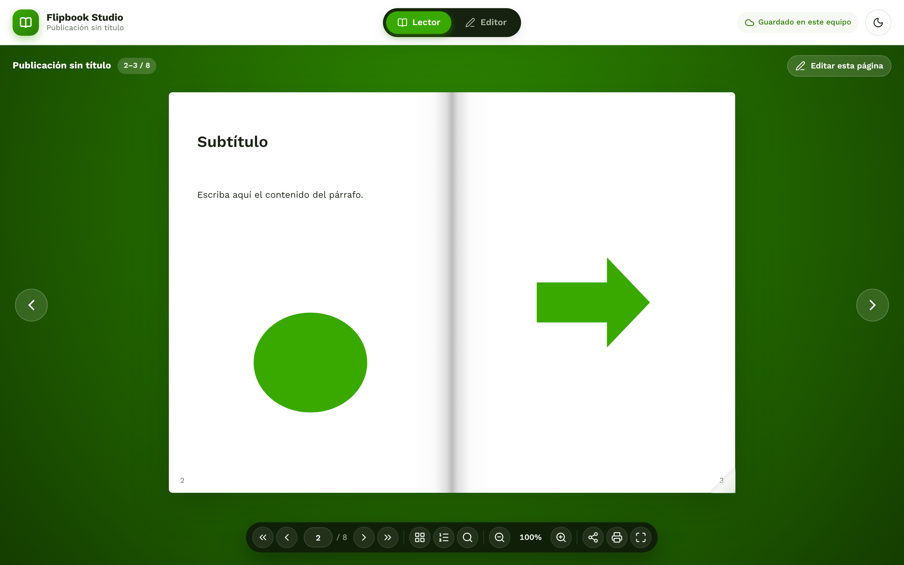
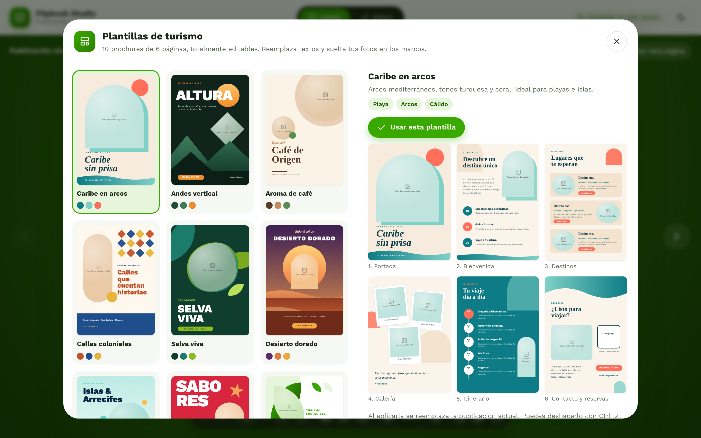

# SENA Flipbook Studio

Editor y lector de publicaciones digitales con **giro de páginas 3D propio**, pensado para
material de formación institucional. Primera versión (v1.0.0): la publicación inicia **en blanco**
y se edita libremente, sin límites de páginas ni de elementos.





## Funcionalidades

**Lector**
- Motor de giro 3D escrito desde cero (CSS 3D + `requestAnimationFrame`), sin librerías de flipbook.
- Doble página en escritorio y lectura secuencial de una página en móvil (cambia automáticamente).
- Giro hacia adelante y hacia atrás con perspectiva, sombras dinámicas, sombra proyectada, lomo y hojas de doble cara.
- Clic en la página, arrastre con ratón o dedo (con inercia), flechas laterales y barra de controles.
- Índice (a partir de los títulos de página), miniaturas y búsqueda sin tildes ni mayúsculas.
- Zoom (50 %–300 %), pantalla completa, compartir (Web Share o copiar enlace) e imprimir / guardar como PDF.
- Enlaces profundos por página (`#/leer?p=5`).
- Sonido al pasar cada hoja, a elegir entre dos grabaciones aportadas por el autor («Hojas de libro»,
  por defecto, y «Libro abriéndose», en `src/assets/sounds/`) y tres sintetizados en el navegador
  («Papel suave», «Brisa y campanita» y «Papel clásico»). Se silencia con el botón
  de la barra o la tecla `M`; en el editor se elige el estilo, se prueba y se puede desactivar.
- Manos de lector realistas con volumen 3D (luz, brillo y textura de piel), vistas desde arriba: pulgar sobre la hoja y dedos detrás del borde, que sostienen el libro y acompañan la hoja al girar. Se ocultan con el
  botón de la mano o la tecla `H`; en el editor se activan o desactivan y se elige tono de piel y manga.
- Teclado: `←` `→` `Re Pág` `Av Pág` `Inicio` `Fin` `+` `-` `0` `F` `M` `H` `Esc`.

**Plantillas de turismo (10)**
- Brochures de 6 páginas listos para editar: *Caribe en arcos*, *Andes vertical*, *Aroma de café*,
  *Calles coloniales*, *Selva viva*, *Desierto dorado*, *Islas y arrecifes*, *Ruta de sabores*,
  *Ecoturismo verde* y *Noches de festival*.
- Cada una con portada única, paleta propia, silueta de fotos (arco, círculo, hoja, hexágono…) y
  páginas de bienvenida, destinos, galería, itinerario y contacto.
- Las fotos son marcos vacíos: doble clic o arrastrar una imagen encima para rellenarlos.
- Ver [docs/PLANTILLAS.md](docs/PLANTILLAS.md).

**Editor**
- Páginas: agregar, duplicar, eliminar, reordenar (arrastrar o botones) y titular.
- Elementos: texto (título, subtítulo, párrafo), imágenes (subir, arrastrar al lienzo o URL https) y
  formas (rectángulo, elipse, arco, onda, orgánica, hoja, hexágono, rombo, triángulo, estrella, flecha, línea)
  con relleno sólido o degradado. Las imágenes admiten marcos con silueta.
- Mover, redimensionar (Mayús = proporcional), rotar (Mayús = 15°), guías de centrado, capas, bloqueo,
  opacidad, colores libres y paleta SENA, tipografía, alineación, interlineado, bordes y radios.
- Fondo de página por color o imagen; formato de página (A4, carta, cuadrado, 16:9); velocidad del giro.
- Deshacer / rehacer, copiar / pegar, duplicar y atajos de teclado.
- Guardado automático en el navegador (IndexedDB) y exportar / importar JSON validado.
- Tema claro y oscuro.

## Inicio rápido

Requisitos: Node.js 20 o superior (recomendado 22).

```bash
npm install
npm run dev        # desarrollo en http://localhost:5173
```

Para ver la versión de producción ya compilada:

```bash
npm install
npm run build
npm run preview    # http://localhost:4173
```

> El `.zip` incluye la carpeta `dist/` ya compilada. Basta con `npm install` y `npm run preview`.
> `dist/index.html` no funciona con doble clic (los navegadores bloquean módulos en `file://`);
> sírvelo con `npm run preview` o cualquier servidor estático.

## Scripts

| Script | Uso |
| --- | --- |
| `npm run dev` | Servidor de desarrollo con recarga en caliente |
| `npm run build` | Verificación de tipos y build de producción en `dist/` |
| `npm run preview` | Sirve el build de producción |
| `npm test` | Pruebas unitarias e integración (Vitest + Testing Library) |
| `npm run test:coverage` | Pruebas con cobertura |
| `npm run lint` | ESLint |
| `npm run typecheck` | TypeScript en modo estricto |
| `npm run check` | Todo lo anterior en cadena (lo que ejecuta la CI) |

## Estructura

```
src/
  config/        Configuración de la app, paleta SENA y formatos (editable sin tocar componentes)
  content/       Contenido inicial en JSON, esquema de validación (Zod) y fábricas
  domain/        Tipos del modelo de publicación
  engine/        Motor de giro 3D: modelo de hojas (puro), animador y componente FlipBook
  components/    Renderizador de páginas compartido (lector, miniaturas, editor, impresión)
  features/
    reader/      Lector: barra, panel de índice/miniaturas/búsqueda, impresión
    editor/      Editor: páginas, lienzo, herramientas, inspector, geometría
  store/         Estado con historial (reductor puro) y persistencia
  lib/           Utilidades: seguridad, enrutador por hash, navegador, hooks
  styles/        Tokens de diseño y estilos globales
docs/            Documentación técnica y capturas
```

Más detalle en [docs/ARQUITECTURA.md](docs/ARQUITECTURA.md).

## Documentación

- [Auditoría inicial](docs/AUDITORIA.md)
- [Análisis de las referencias (video y estilo)](docs/ANALISIS_VIDEO.md)
- [Arquitectura y motor de giro](docs/ARQUITECTURA.md)
- [Contenido administrable](docs/CONTENIDO.md)
- [Seguridad, accesibilidad y rendimiento](docs/CALIDAD.md)
- [Despliegue en GitHub](docs/DESPLIEGUE.md)

## Identidad visual

Se usa el verde institucional **#39A900** y derivados (tintes y sombras), tipografía **Work Sans** y
neutros. No se incluyen logotipos ni recursos de marca: deben agregarse con autorización y según el
Manual de Identidad vigente. Toda la paleta está en `src/config/app.config.ts` y `src/styles/tokens.css`.

## Licencia

Pendiente de definir por la entidad propietaria antes de publicar el repositorio.
